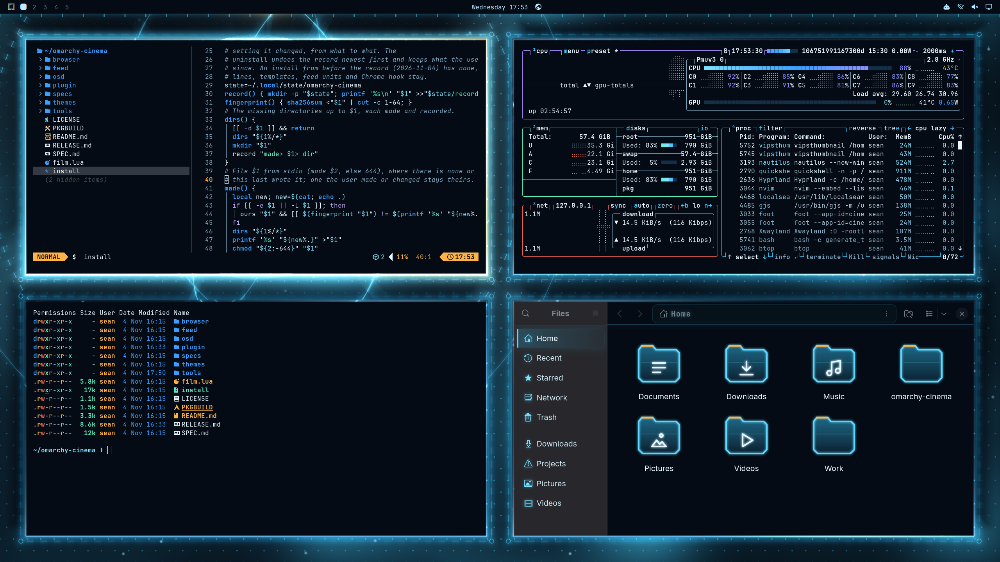
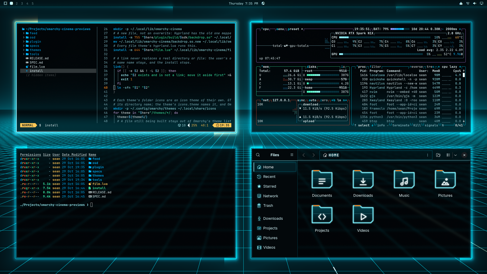
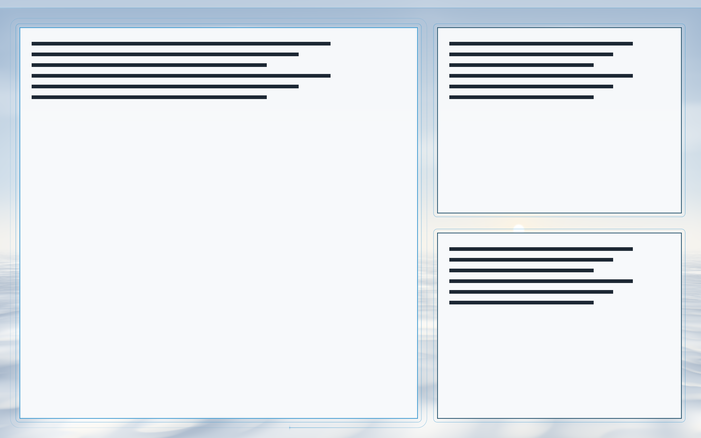
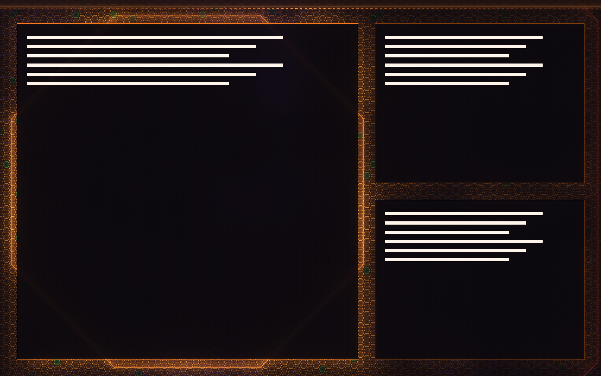
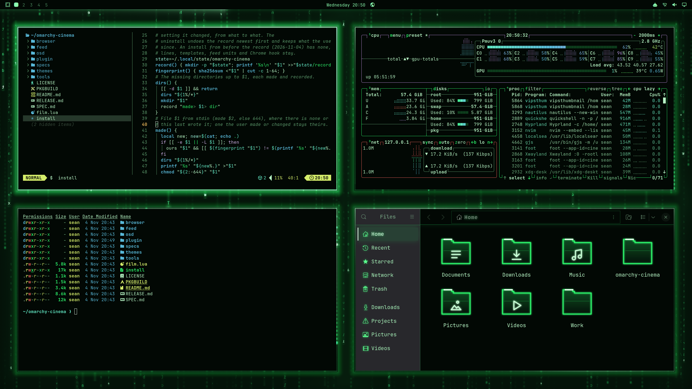
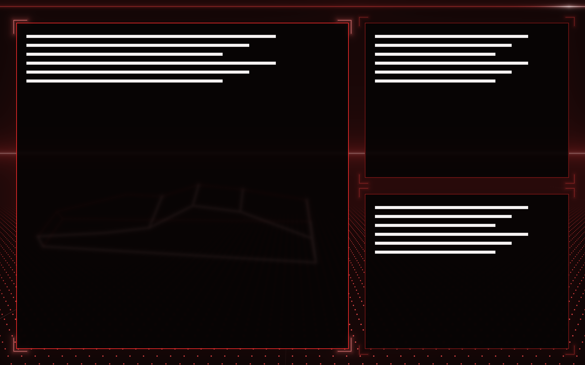

# Omarchy Cinema

Six film themes for [Omarchy](https://omarchy.org) whose background is alive
and drawn around your windows, in the same frame as the windows. Windows turn
to glass with their text kept solid, and Files, its folders, the bar and the
dictation popup take the film's look. A still desktop costs nothing; the
film moves while your windows do.

| | |
|---|---|
|  **Jarvis** (Iron Man) |  **Tron Legacy** |
|  **Oblivion** |  **Evangelion** |
|  **The Matrix** |  **Roadster** (the 2026 Tesla Roadster's UI) |

## Install

Needs Omarchy's edge channel, with Hyprland 0.57: Omarchy stable still
ships Hyprland 0.56, which the engine does not build against. This is a
beta, used on one aarch64 laptop with an NVIDIA GPU; CI builds it on
x86_64 and aarch64 against Omarchy edge's Hyprland every day, and
it is untested on other GPUs. The backdrop is a Hyprland plugin, which
starts only at a login:

1. `git clone https://github.com/seankd3/omarchy-cinema ~/omarchy-cinema`
2. `~/omarchy-cinema/install` (it builds the plugin, about a minute).
3. Log out and in.
4. Pick a film in the theme menu (Super+Ctrl+T), or `omarchy theme set jarvis`.

After a Hyprland update, run `~/omarchy-cinema/install` again, then log out
and in: the plugin loads only into the Hyprland it was built for.

Omarchy's own toggles tune it: *Glassy windows* or *Opaque windows*, and
*No animations*, which holds the backdrop still.

The Matrix rains its own code, or the text your Claude Code and Codex agents
write, read from their logs on this machine and kept only in memory. That is
off, since whatever an agent prints, secrets included, would show on your
desktop and in a screen share. To turn it on:
`systemctl --user enable --now omarchy-cinema-agents` (`disable --now` turns
it off).

## Uninstall

Log out, and from the console (step 2):
`~/omarchy-cinema/install --uninstall`. It takes away what the install added
and only that, keeps what you changed since, and puts back the Voxtype
settings it changed; a film still applied gives way to Tokyo Night.

## Make your own

The [playground](https://seankd3.github.io/omarchy-cinema/play/) draws a film
in the browser around windows you drag, with nothing installed: pick one of
a film, edit its `backdrop.frag` and watch it change. Load your own repo by
its GitHub URL, and give it the topic `omarchy-cinema` to list it there. The
second line of `backdrop.frag` names the film, up to its first colon or full
stop: `// Tron Legacy: the Grid. ...`.

Copy a film's directory into `~/.config/omarchy/themes/<name>`, change
`colors.toml`, and write `backdrop.frag`: one GLSL function, `backdrop(px)`,
against [the contract](https://seankd3.github.io/omarchy-cinema/play/contract.html)
(`plugin/contract.glsl`, which says everything a film can read and what its
`colors.toml` sets).
`uv run tools/preview.py <theme-dir>` draws it off screen, once you lock
the screen or it sleeps: benches yield to the person at the screen
(`tools/yield`). SPEC.md is the design.

## Credits

These themes are fan homages. Iron Man and J.A.R.V.I.S. (Marvel), Tron:
Legacy (Disney), Oblivion (Universal Pictures), Neon Genesis Evangelion
(khara), The Matrix (Warner Bros.) and Tesla Roadster (Tesla) belong to
their owners. This project is not affiliated with or endorsed by any of
them, and it ships no film imagery: every wallpaper
(`themes/*/backgrounds/0-*.png`) is that film's own `backdrop.frag` drawn by
`tools/preview.py`, each `preview.png` is a capture of a hidden desktop by
`tools/theme-previews`, the folder icons are drawn by `tools/folders.py`, and
The Matrix's `glyphs.png` is JetBrains Mono (SIL Open Font License 1.1)
drawn by `tools/glyphs.py`.

MIT licence (LICENSE).
